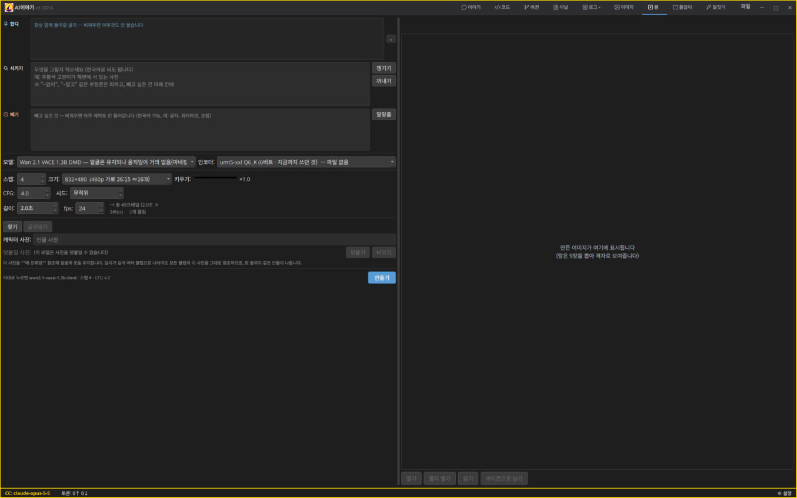

# AIIyagi

A desktop app to code, draw and make video with AI.

AI와 함께 코딩하고, 그림과 영상을 만드는 데스크톱 앱.

- Run several AI coding jobs per project side by side and review what the AI changed
- Chat with Claude Code, Claude API, Ollama, local models or Manus
- Make images and video on your own PC's GPU — no online service needed
- An AI director that carries a one-line idea through storyboard, video and sound

- 프로젝트마다 AI 코딩 일을 여러 개 동시에 돌리고, AI가 고친 것을 살펴보고 받아들입니다
- Claude Code·Claude API·Ollama·내 PC 모델·Manus 중에서 골라 대화합니다
- 그림과 영상을 인터넷 서비스 없이 내 PC의 GPU로 만듭니다
- 한마디를 넣으면 기획 → 스토리보드 → 영상 → 소리까지 이어 만드는 AI 감독

> Not released yet — downloads will appear under [Releases](../../releases) when it is ready.
> 아직 공개 전입니다. 준비되면 [Releases](../../releases)에 올라옵니다.

